  

  <a href="https://www.linkedin.com/in/weiweihu/">LinkedIn</a> ·
  <a href="https://weiweihu.carrd.co/">Website</a> ·
  <a href="https://www.linkedin.com/build-relation/newsletter-follow?entityUrn=7433145050123026432">Afterglimpse</a> ·
  <a href="https://behindprompt.substack.com/">Substack</a> ·
  <a href="https://wei-wei-hu.github.io/ai-hub/">AI Hub</a> ·
  <a href="https://www.amazon.com/dp/B0FX2B9WH4">GEO Book</a>

---

### 👋 Hi, I'm Weiwei.

I'm a strategy and transformation leader focused on turning AI and data into better decisions, smarter ways of working, and measurable business value. My work spans enterprise AI and digital transformation, cross-functional operations, and AI/ML and agentic AI for business and investment decisions. I also lead a 3,000-member data science community.

Here you’ll find what I’m working on. **Work** is where I share the systems, frameworks, and tools I create for AI transformation. **Things I Create** is where I share ideas and tools that started with something I wanted to build for myself.

---

## 💼 My Work

I focus on one question: **How do you move AI from experimentation to changing how the business actually works?**

My approach follows five connected parts: build fluency, preserve expertise, transform workflows, measure value, and create the operating system that keeps it moving.

  

### 01 · Build AI fluency & adoption

Give people a reason to use AI, then help them get good at using it on real work.

| &nbsp;&nbsp;&nbsp;&nbsp;&nbsp;&nbsp;&nbsp;&nbsp;&nbsp;&nbsp;&nbsp;&nbsp;&nbsp;&nbsp;&nbsp;&nbsp;&nbsp;&nbsp;&nbsp;&nbsp;&nbsp;&nbsp;&nbsp;&nbsp;&nbsp;Deliverable&nbsp;&nbsp;&nbsp;&nbsp;&nbsp;&nbsp;&nbsp;&nbsp;&nbsp;&nbsp;&nbsp;&nbsp;&nbsp;&nbsp;&nbsp;&nbsp;&nbsp;&nbsp;&nbsp;&nbsp;&nbsp;&nbsp;&nbsp;&nbsp;&nbsp; |  What it does |
| --- | --- |
| 🧭 **AI Fluency Self-Assessment** | Identifies where someone is today and creates a practical 30-day learning path |
| 🏆 **AI Champions Kit** | Gives champions the workshops, tools and working sessions to help adoption spread through a team |
| 🧰 **[everyday-ai-playbook](https://wei-wei-hu.github.io/everyday-ai-playbook/)** | 25 practical ways to use AI across work, decisions, time and everyday life |
| 📡 **enterprise-ai-digest** | Turns a week of enterprise AI news into a five-minute executive brief |

### 02 · Preserve knowledge & expertise

Turn expert knowledge into something teams and AI can use.

| &nbsp;&nbsp;&nbsp;&nbsp;&nbsp;&nbsp;&nbsp;&nbsp;&nbsp;&nbsp;&nbsp;&nbsp;&nbsp;&nbsp;&nbsp;&nbsp;&nbsp;&nbsp;&nbsp;&nbsp;&nbsp;&nbsp;&nbsp;&nbsp;&nbsp;Deliverable&nbsp;&nbsp;&nbsp;&nbsp;&nbsp;&nbsp;&nbsp;&nbsp;&nbsp;&nbsp;&nbsp;&nbsp;&nbsp;&nbsp;&nbsp;&nbsp;&nbsp;&nbsp;&nbsp;&nbsp;&nbsp;&nbsp;&nbsp;&nbsp;&nbsp; |  What it does |
| --- | --- |
| 🧠 **Expert-to-Skill Kit** | Captures an expert's judgment through guided interviews and turns it into a reusable AI skill |
| 📒 **Decision Log** | Preserves what was decided, why it was decided and what was expected to happen |

### 03 · Transform business workflows

Start with the work itself. Decide where AI should assist, improve, redesign, and where people should remain in control.

| &nbsp;&nbsp;&nbsp;&nbsp;&nbsp;&nbsp;&nbsp;&nbsp;&nbsp;&nbsp;&nbsp;&nbsp;&nbsp;&nbsp;&nbsp;&nbsp;&nbsp;&nbsp;&nbsp;&nbsp;&nbsp;&nbsp;&nbsp;&nbsp;&nbsp;Deliverable&nbsp;&nbsp;&nbsp;&nbsp;&nbsp;&nbsp;&nbsp;&nbsp;&nbsp;&nbsp;&nbsp;&nbsp;&nbsp;&nbsp;&nbsp;&nbsp;&nbsp;&nbsp;&nbsp;&nbsp;&nbsp;&nbsp;&nbsp;&nbsp;&nbsp; |  What it does |
| --- | --- |
| 🔍 **Workflow Opportunity Scanner** | Breaks down a workflow and identifies where AI can automate, assist or remain human-led |
| 🏗️ **workflow-architect** | Takes a workflow from process mapping through AI opportunities, requirements and agent specifications |

### 04 · Measure transformation success

Measure how AI improves the way work gets done, creates business value, and delivers financial results.

| &nbsp;&nbsp;&nbsp;&nbsp;&nbsp;&nbsp;&nbsp;&nbsp;&nbsp;&nbsp;&nbsp;&nbsp;&nbsp;&nbsp;&nbsp;&nbsp;&nbsp;&nbsp;&nbsp;&nbsp;&nbsp;&nbsp;&nbsp;&nbsp;&nbsp;Deliverable&nbsp;&nbsp;&nbsp;&nbsp;&nbsp;&nbsp;&nbsp;&nbsp;&nbsp;&nbsp;&nbsp;&nbsp;&nbsp;&nbsp;&nbsp;&nbsp;&nbsp;&nbsp;&nbsp;&nbsp;&nbsp;&nbsp;&nbsp;&nbsp;&nbsp; |  What it does |
| --- | --- |
| 📈 **[AI Performance & ROI](https://wei-wei-hu.github.io/ai-performance-roi/)** | Measures AI adoption, operational performance and business value, with an ROI calculator for investment decisions |
| 🎯 **AI Value Scorecard** | Tracks whether AI is improving time, quality, adoption and business outcomes |
| 🔁 **AI Operating Kit** | Creates a recurring management process for reviewing the portfolio, results, decisions and next actions |

### 05 · Lead transformation & operations

Transformation needs an operating system around the technology: priorities, decisions, ownership, communication and follow-through.

| &nbsp;&nbsp;&nbsp;&nbsp;&nbsp;&nbsp;&nbsp;&nbsp;&nbsp;&nbsp;&nbsp;&nbsp;&nbsp;&nbsp;&nbsp;&nbsp;&nbsp;&nbsp;&nbsp;&nbsp;&nbsp;&nbsp;&nbsp;&nbsp;&nbsp;Deliverable&nbsp;&nbsp;&nbsp;&nbsp;&nbsp;&nbsp;&nbsp;&nbsp;&nbsp;&nbsp;&nbsp;&nbsp;&nbsp;&nbsp;&nbsp;&nbsp;&nbsp;&nbsp;&nbsp;&nbsp;&nbsp;&nbsp;&nbsp;&nbsp;&nbsp; |  What it does |
| --- | --- |
| ✉️ **Leader's Brief Pack** | Turns complex work into concise executive decision memos and stakeholder updates |
| 🏭 **AI Use Case & Agent Factory** | Keeps every use case and agent in one portfolio with its owner, stage, value and next decision |
| 🎙️ **[From Data to Decisions](https://www.productcoalition.com/p/ep103-from-data-to-decisions-making)** | Product Coalition conversation on turning analytics into decisions and action with AI |
| 🎤 **[Data + AI Summit 2025](https://www.databricks.com/dataaisummit/speaker/weiwei-hu)** | My talk on connecting big-data strategy to business priorities |

### ✍️ What I Write About

I write about what I learn from working at the intersection of AI, data, leadership and operations.

| &nbsp;&nbsp;&nbsp;&nbsp;&nbsp;&nbsp;&nbsp;&nbsp;&nbsp;&nbsp;&nbsp;&nbsp;&nbsp;&nbsp;&nbsp;&nbsp;&nbsp;&nbsp;&nbsp;&nbsp;&nbsp;&nbsp;&nbsp;&nbsp;&nbsp;&nbsp;&nbsp;&nbsp;&nbsp;Writing&nbsp;&nbsp;&nbsp;&nbsp;&nbsp;&nbsp;&nbsp;&nbsp;&nbsp;&nbsp;&nbsp;&nbsp;&nbsp;&nbsp;&nbsp;&nbsp;&nbsp;&nbsp;&nbsp;&nbsp;&nbsp;&nbsp;&nbsp;&nbsp;&nbsp;&nbsp;&nbsp;&nbsp;&nbsp; |  What it is |
| --- | --- |
| 📰 **[Afterglimpse](https://www.linkedin.com/build-relation/newsletter-follow?entityUrn=7433145050123026432)** | Tech, leadership and the operations that connect them |
| ✍️ **[Behind The Prompt](https://behindprompt.substack.com/)** | Essays on technology, leadership and innovation, including my **[Make AI Work](https://behindprompt.substack.com/s/make-ai-work)** series |
| 📘 **[Generative Engine Optimization](https://www.amazon.com/dp/B0FX2B9WH4)** | My book on getting found when people ask AI before they ask Google |
| 📝 **[Towards Data Science](https://towardsdatascience.com/author/weiwei.hu/)** | My articles on making AI work, including workflow redesign, AI agents and business impact |

---

## 🌿 Things I Create

I’m always curious and love creating things. Some of my favorite projects grow out of everyday life and the things I care about.

  

| &nbsp;&nbsp;&nbsp;&nbsp;&nbsp;&nbsp;&nbsp;&nbsp;&nbsp;&nbsp;&nbsp;&nbsp;&nbsp;&nbsp;&nbsp;&nbsp;&nbsp;&nbsp;&nbsp;&nbsp;&nbsp;&nbsp;&nbsp;&nbsp;&nbsp;&nbsp;&nbsp;&nbsp;&nbsp;Project&nbsp;&nbsp;&nbsp;&nbsp;&nbsp;&nbsp;&nbsp;&nbsp;&nbsp;&nbsp;&nbsp;&nbsp;&nbsp;&nbsp;&nbsp;&nbsp;&nbsp;&nbsp;&nbsp;&nbsp;&nbsp;&nbsp;&nbsp;&nbsp;&nbsp;&nbsp;&nbsp;&nbsp;&nbsp; |  What it does |
| --- | --- |
| ⚡ **[AI Hub](https://wei-wei-hu.github.io/ai-hub/)** | Brings my practical AI tools, guides and experiments together in one place |
| 💡 **[Underline AI](https://wei-wei-hu.github.io/underline-ai/)** | Applies ideas from a curated library to a real situation and gives you what to do, what to say and what to do next |
| 📋 **[Program Status Board](https://wei-wei-hu.github.io/program-management/)** | Keeps projects, milestones, dependencies and updates together, then turns the record into weekly and monthly reports |
| 🪡 **[The Atelier](https://wei-wei-hu.github.io/the-atelier/)** | Helps you plan what matters at work and in life, then keeps a record of what you accomplish |
| 🧭 **[Life Designer Pro](https://wei-wei-hu.github.io/life-designer-pro/)** | Helps you explore possible career and life paths and turn them into concrete experiments |
| 🥗 **[Evera Table](https://everatable.pages.dev)** | Turns what you already have in your kitchen into meals you actually want to make |

---

## 📬 Connect with me

  
  

---

© 2026 Weiwei Hu. All rights reserved. No part of this profile or its assets may be copied, modified or redistributed without written permission. See <a href="./LICENSE">LICENSE</a>.

